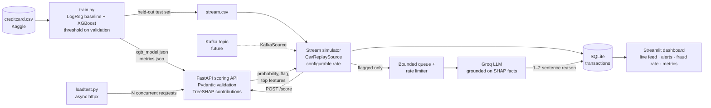

# 🛡️ FraudPulse — Real-Time AI Fraud Detection

An end-to-end fraud detection system: an **XGBoost** model trained on heavily imbalanced card data, served by a **FastAPI** scoring API, fed by a **real-time stream simulator**, with **SHAP-grounded LLM explanations (Groq)** for every alert and a live **Streamlit + Plotly** dashboard. Load-tested for throughput and latency.

> 📘 New to the project? Follow **[docs/GUIDE.md](docs/GUIDE.md)**. It walks through every step on Windows and explains what each file does.

## Architecture



**Key design decisions**
- **Imbalance handled properly:** stratified splits, `class_weight="balanced"` / `scale_pos_weight`, and evaluation by **PR-AUC, precision, recall, F1** (not accuracy).
- **Threshold chosen on validation data** (max F1), then reported once on the untouched test set, so there's no leakage.
- **Scoring is decoupled from explaining.** The API stays fast. Only flagged transactions go to the LLM, through a bounded queue paced to the Groq free-tier limit, with a deterministic fallback.
- **Explanations are grounded.** The LLM only sees the model's own TreeSHAP contributions, so it can't make up reasons.
- **Kafka-ready.** The simulator depends on an abstract `TransactionSource`, so adding Kafka means writing one new class.

## Results

**Model** (held-out test set: 56,962 transactions, 99 frauds; threshold chosen on the validation set)

| Model | Threshold | Precision | Recall | F1 | PR-AUC | ROC-AUC |
|---|---|---|---|---|---|---|
| Logistic Regression (baseline) | 1.0000 | 0.888 | 0.798 | 0.840 | 0.759 | 0.969 |
| **XGBoost** | 0.9295 | **0.952** | **0.808** | **0.874** | **0.875** | **0.980** |

Predicting "always legit" would score 99.83% accuracy while catching zero fraud, so accuracy is not used as the headline metric.

**API load test** (2,000 requests per run, 4 uvicorn workers, 0 errors)

| Concurrent clients | Throughput | p50 latency | p95 latency |
|---|---|---|---|
| 1 | 65 req/s | 10.8 ms | 27.1 ms |
| 20 | **171 req/s** | 81.1 ms | 353.7 ms |

_Windows 11 laptop, with the load-test client and the API on the same machine (they compete for CPU, which inflates tail latency)._

**Live stream demo:** 500 replayed transactions, 7 alerts, all 7 confirmed fraud, and all 7 explained by the Groq LLM (`openai/gpt-oss-20b`).

## Tech stack

| Layer | Tools |
|---|---|
| ML | Python, pandas, scikit-learn, XGBoost (native TreeSHAP) |
| API | FastAPI, Pydantic v2, Uvicorn |
| Streaming | Python producer with pluggable sources (CSV replay now, Kafka-ready) |
| Storage | SQLite (WAL mode) |
| GenAI | Groq LLM API (model configurable in `.env`), rate-limited worker queue |
| Dashboard | Streamlit, Plotly |
| Quality | pytest, async load testing (httpx + asyncio) |
| Packaging | Docker, `.env` config |

## Quickstart (Windows PowerShell)

```powershell
python -m venv .venv
.\.venv\Scripts\Activate.ps1
pip install -r requirements.txt
copy .env.example .env            # then put your GROQ_API_KEY in .env

# put creditcard.csv in data\  (see docs/GUIDE.md, Step 2)
python -m src.train

# Terminal 1: API
uvicorn src.api.main:app --port 8000
# Terminal 2: live stream
python -m src.stream.simulator --rate 5 --limit 1000 --fraud-ratio 0.02 --reset-db
# Terminal 3: dashboard
streamlit run src/dashboard/app.py

python -m src.loadtest --requests 2000 --concurrency 20
pytest -v
```

## Project structure

```
fraudpulse/
├── src/
│   ├── config.py            # .env settings and paths
│   ├── features.py          # feature engineering shared by training and serving
│   ├── synthetic.py         # fake data for tests and smoke runs
│   ├── train.py             # baseline + XGBoost, metrics, threshold, saves model
│   ├── db.py                # SQLite storage
│   ├── report.py            # prints the Markdown results tables
│   ├── loadtest.py          # throughput and latency benchmark
│   ├── api/
│   │   ├── main.py          # FastAPI app: /health, /score
│   │   ├── schemas.py       # Pydantic request/response models
│   │   └── model_service.py # loads the model, scores, SHAP top features
│   ├── stream/
│   │   ├── sources.py       # TransactionSource interface, CSV replay, Kafka stub
│   │   └── simulator.py     # replays transactions to the API at N tx/s
│   ├── explain/
│   │   ├── llm.py           # Groq call, grounded prompt, template fallback
│   │   └── worker.py        # background queue + rate limiter
│   └── dashboard/app.py     # Streamlit live dashboard
├── tests/                   # pytest (self-contained; trains a tiny model)
├── scripts/                 # dataset download and synthetic data
├── Dockerfile, requirements*.txt, .env.example
```

## Dataset

[Credit Card Fraud Detection (ULB)](https://www.kaggle.com/datasets/mlg-ulb/creditcardfraud): 284,807 European card transactions, 492 of them fraud (0.172%). The `V1–V28` columns are anonymized PCA components, so explanations refer to them as "anonymized behaviour signals." A dataset with named features (e.g. IEEE-CIS) would give richer explanations without changing the pipeline.
